<h1 align="center">
  <a href="https://dragent.dev">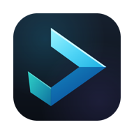</a>&nbsp;Dragent
</h1>

  <strong>Stop babysitting AI terminals. Run an agent team.</strong>

  Give a lead agent your goal. It splits the work across isolated Git worktrees,
  hands each part to Claude Code, Codex or any agent you use, and asks you only
  when a decision is yours.

  <a href="https://dragent.dev/download"><strong>Download</strong></a> &nbsp;·&nbsp;
  <a href="https://dragent.dev/docs">Docs</a> &nbsp;·&nbsp;
  <a href="https://dragent.dev">Website</a> &nbsp;·&nbsp;
  <a href="#build-from-source">Build from source</a>

  
  
  

  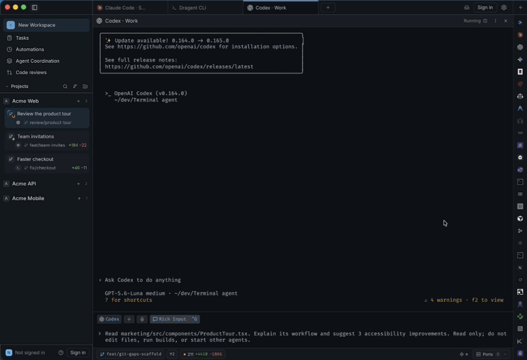

## Features

### Run an agent team

The lead plans the work, decides who does what and what has to wait, and each
worker gets its own worktree and files. You follow one page: who started what,
what finished, and the questions that are yours to answer. Reply there, or from
your phone.

<a href="https://dragent.dev/docs/coordination">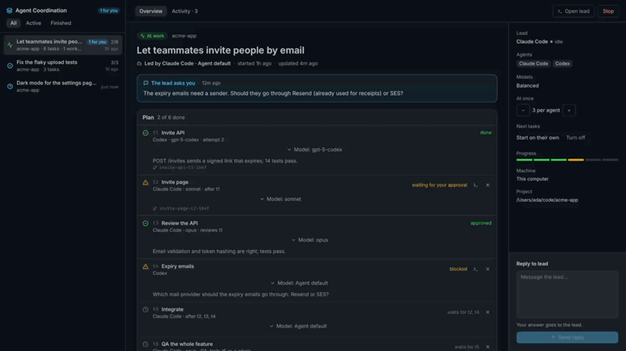</a>

### Start from one prompt

Pick the machine, the project and the agent, describe the task, and Dragent
makes the workspace: a branch of its own, a terminal, an editor, and the agent
already at work.

<a href="https://dragent.dev/docs/workspaces">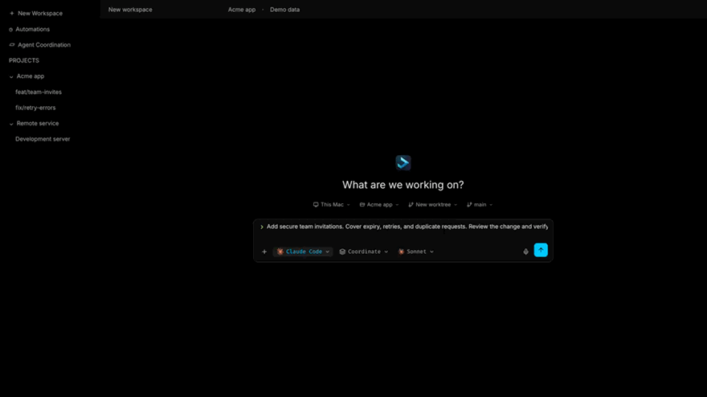</a>

### An agent built into the workspace

Explore a codebase, plan a change and follow it through. Read the explanation,
expand the tool activity, and approve what the agent wants to run. It works
with Claude, OpenAI, Grok and other models, on our servers or with your own
keys, which never leave your computer.

<a href="https://dragent.dev/docs/agent">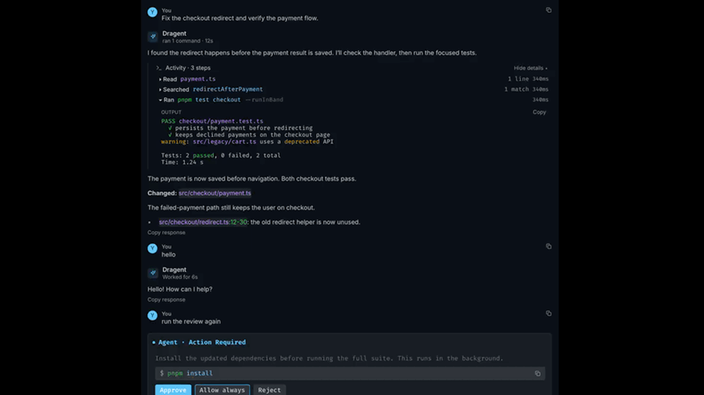</a>

### The agent wrote it. You should understand it.

GitHub pull requests and GitLab merge requests from every project in one inbox:
the files, the checks, the discussion. Comment on a line, have an agent review
it, open its workspace, or merge once the checks pass.

<a href="https://dragent.dev/docs/code-review">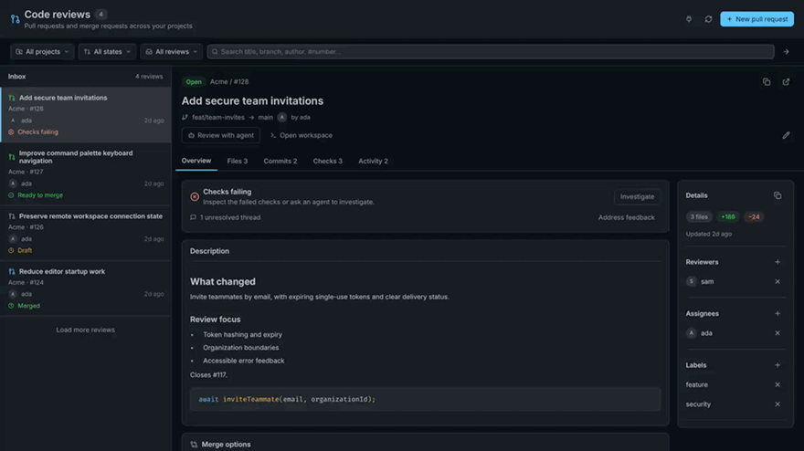</a>

### The right machine. The same workspace.

Keep the code and the compute on your SSH host and bring its files, terminal,
Git and agents into Dragent. Each machine keeps its own agent accounts, by
subscription or API key, signed in on that machine.

<a href="https://dragent.dev/docs/remote-ssh">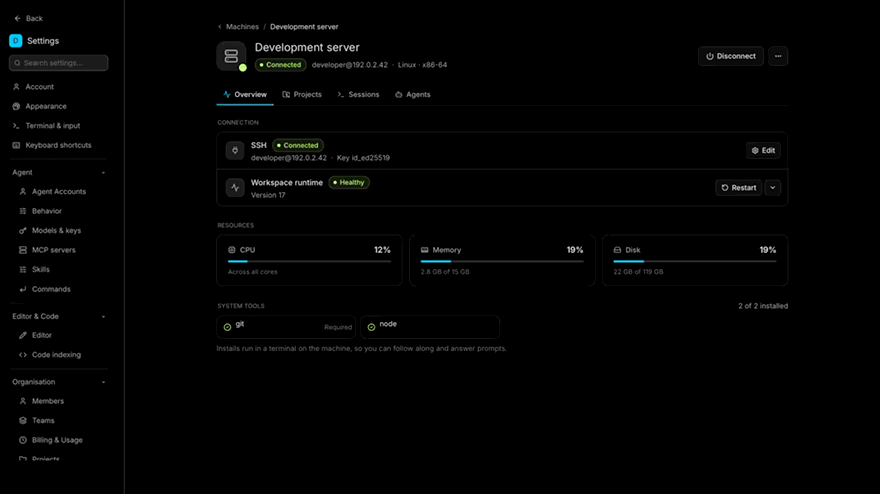</a>

### Your agents, in your pocket

<table>
  <tr>
    <td width="300" valign="top">
      <a href="https://dragent.dev/docs/mobile">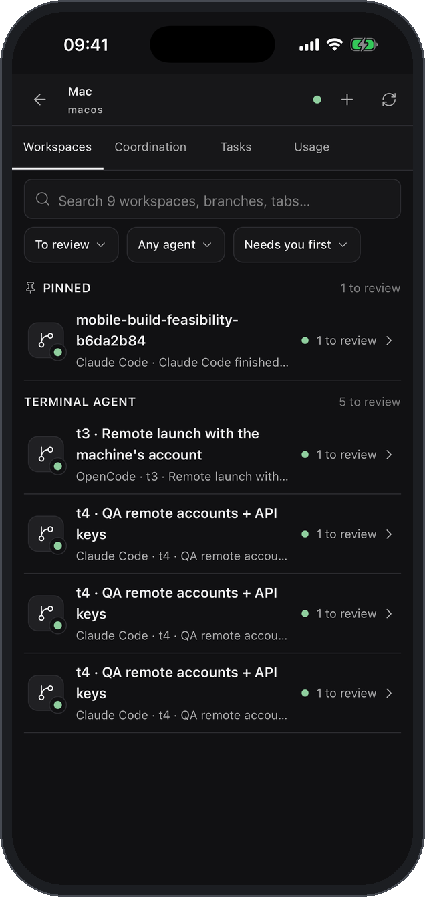</a>
    </td>
    <td valign="top">
      Pair your phone once by scanning a code on your desktop. When an agent
      needs you, the question reaches your phone: answer it, follow the chat,
      or pick up a terminal, and the work keeps going on your machine.
        
      Every workspace on your desktops is there, the ones that need you first,
      along with your agent teams, tasks and usage.
        
      Phone and desktop talk end to end encrypted: the relay only ever
      forwards ciphertext.
        
      <a href="https://dragent.dev/docs/mobile">More about the phone app</a>
    </td>
  </tr>
</table>

### A browser your agents can use

Every workspace has a real browser beside the code. Agents open the app they
built, click through it and check the screen at desktop and phone widths, and
you can step in whenever you like.
[More about the browser](https://dragent.dev/docs/browser)

<strong>And more</strong>: automations, integrations, CLI and MCP

 

<table>
  <tr>
    <td width="50%" valign="top">
      <strong><a href="https://dragent.dev/docs/automations">Automations</a></strong> 
      Agents that start on a schedule, in a project or on their own.  
      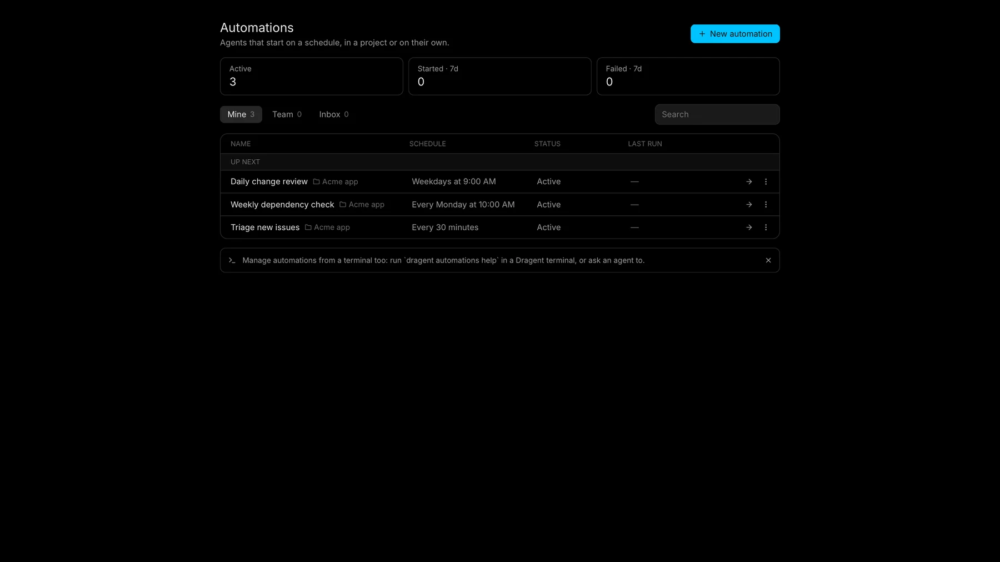
    </td>
    <td width="50%" valign="top">
      <strong><a href="https://dragent.dev/docs/integrations">Integrations</a></strong> 
      Start work from an issue in Linear, GitHub, GitLab, Jira, Sentry and more.  
      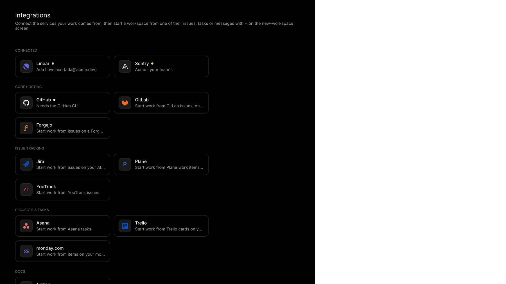
    </td>
  </tr>
</table>

- **[CLI](https://dragent.dev/docs/cli):** inspect sessions, create workspaces and start teams from any terminal.
- **[MCP](https://dragent.dev/docs/mcp):** give agents Dragent's coordination, browser and workspace tools.
- **[Agent accounts](https://dragent.dev/docs/agent-accounts):** several sign-ins per agent (Work, Personal), chosen per project or per session.

## Supported agents

Bring any agent onto the team, and keep your own subscriptions.

  <a href="https://dragent.dev/docs/agents">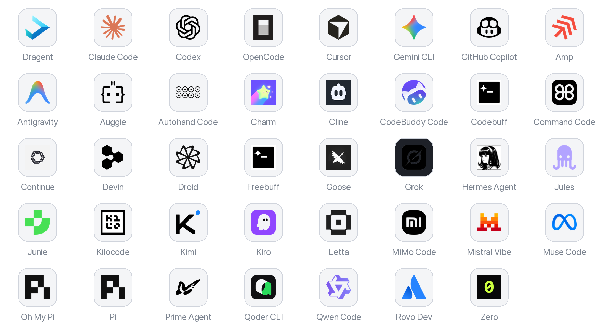</a>

Any other command-line agent can be added by its command.

## Install

Download Dragent for macOS or Windows from **[dragent.dev/download](https://dragent.dev/download)**.
The [quickstart](https://dragent.dev/docs/quickstart) takes you from install to
your first agent team.

## Build from source

| Folder | What it is | Built with |
|---|---|---|
| [`dragent/`](dragent/) | The desktop app: terminal, agents, workspaces, coordination, browser | Rust |
| [`server/`](server/) | The API and the relay between desktops and phones | Go |
| [`mobile/`](mobile/) | The phone companion | Expo / React Native |
| [`auth-portal/`](auth-portal/) | Sign-in and account pages | Next.js |
| [`contracts/`](contracts/) | Wire formats shared by the apps | JSON / schemas |

- **Desktop:** `cd dragent && cargo run -p dragent` (the toolchain version is
  pinned in `dragent/rust-toolchain.toml`).
- **Server:** `cd server && go run ./cmd/api` (needs PostgreSQL and Redis;
  configuration is read from the environment, see
  `server/internal/platform/config`).
- **Phone:** `cd mobile && pnpm install && pnpm start`.
- **Auth portal:** `cd auth-portal && npm ci && npm run dev`.

Each folder's README has the details.

## Contributing

Read [CONTRIBUTING.md](CONTRIBUTING.md) first. Every pull request runs the
checks listed in [.github/REQUIRED_CHECKS.md](.github/REQUIRED_CHECKS.md)
(builds, tests, linters, secret scanning, dependency and license checks) and
needs a maintainer's review. Contributors sign the [CLA](CLA.md).

## Security

Please don't open public issues for security problems. Report them as
described in [SECURITY.md](SECURITY.md).

## License

Dragent is licensed under the GNU Affero General Public License, version 3
only ([AGPL-3.0-only](LICENSE)). If you run a modified version for others
over a network, you must offer them its source. See
[LICENSING.md](LICENSING.md) for details, and
[`dragent/NOTICE`](dragent/NOTICE) and
[`dragent/THIRD_PARTY_NOTICES.md`](dragent/THIRD_PARTY_NOTICES.md) for
third-party components.
